# Sakshi Khadgi

**Editorial & Content Lead** · Bengaluru, India

Editorial & Content Lead with a background in fashion management and design, experienced across editorial strategy, event coordination, and digital marketing. Skilled in creative design tools, blending fashion expertise with content storytelling for global and Indian markets.

[Email](mailto:Saakshikhadgi912@gmail.com) · [LinkedIn](https://www.linkedin.com/in/sakshi-khadgi-005890156/)

## Work

### Trousseau Tales
*Editorial · ICH Creative Consulting*

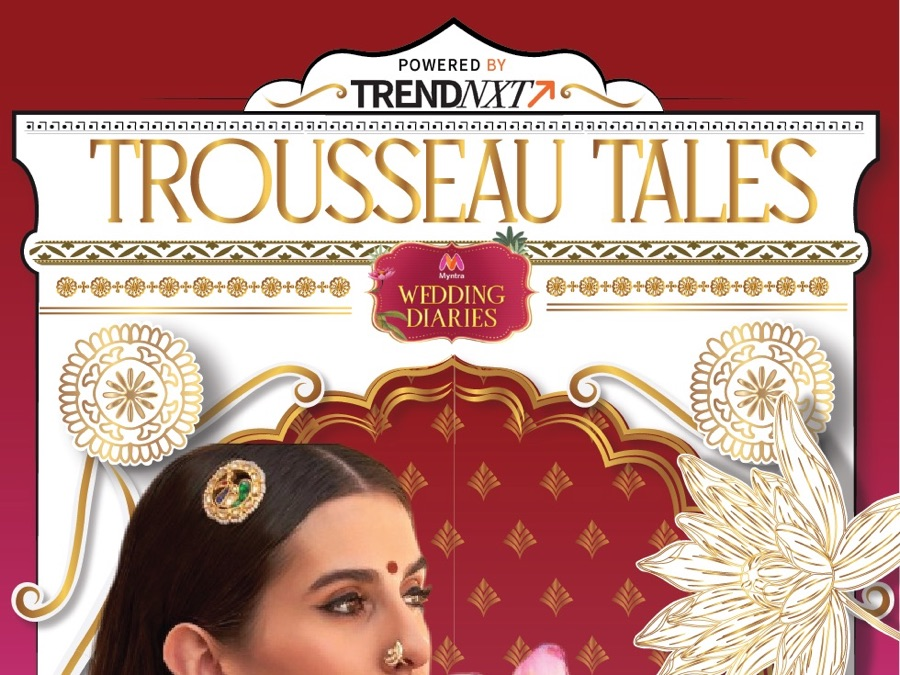

A wedding-season editorial for Myntra's TrendNXT, taking the bride from "After the Wedding?" rituals to a trousseau checklist and honeymoon essentials.

[View editorial](assets/projects/img/trousseau-tales.jpg) · [Watch walkthrough](assets/projects/video/trousseau-tales.mp4)

### Phoolon Ki Rangoli
*Editorial · ICH Creative Consulting*

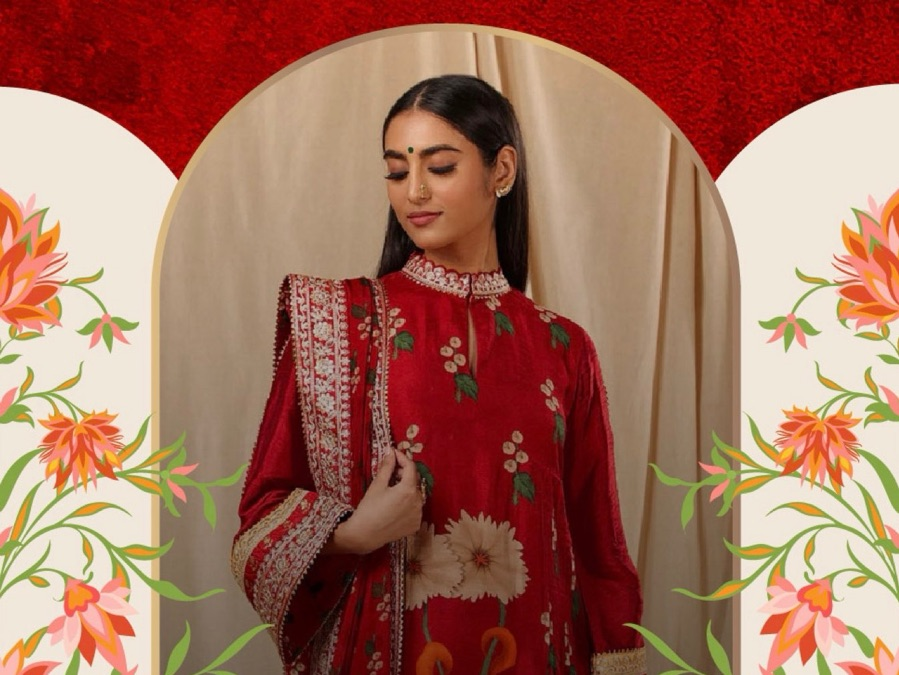

A floral festive fusion edit with easy-to-pair picks for women and men, a "Find your Festive Mood" grid named after flowers, and a grooming section.

[View editorial](assets/projects/pdf/phoolon-ki-rangoli.pdf) · [Watch walkthrough](assets/projects/video/phoolon-ki-rangoli.mp4)

### Art for Your Feet
*Editorial · ICH Creative Consulting*

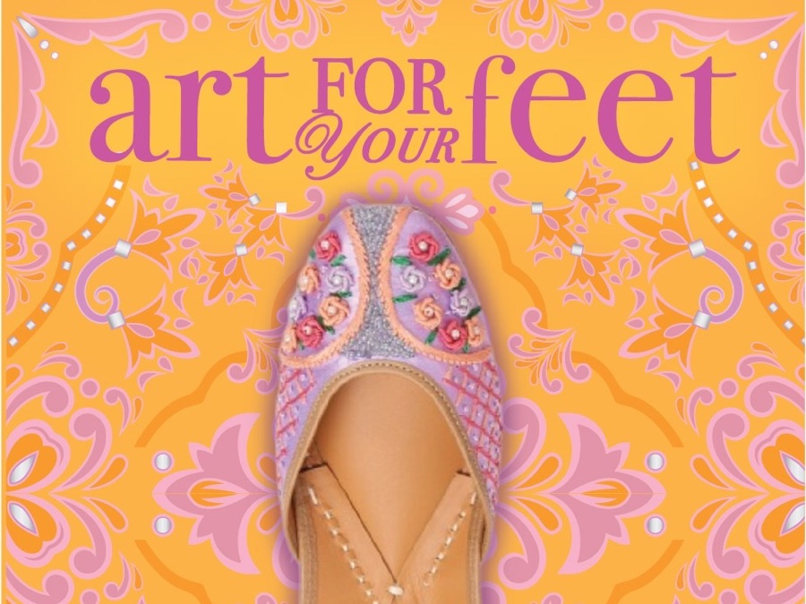

A festive footwear editorial pairing each style — juttis, Kolhapuris, mules and more — with hand-drawn ornamental motifs.

[View editorial](assets/projects/img/art-for-your-feet.jpg) · [Watch walkthrough](assets/projects/video/art-for-your-feet.mp4)

### Rangrez
*Editorial · ICH Creative Consulting*

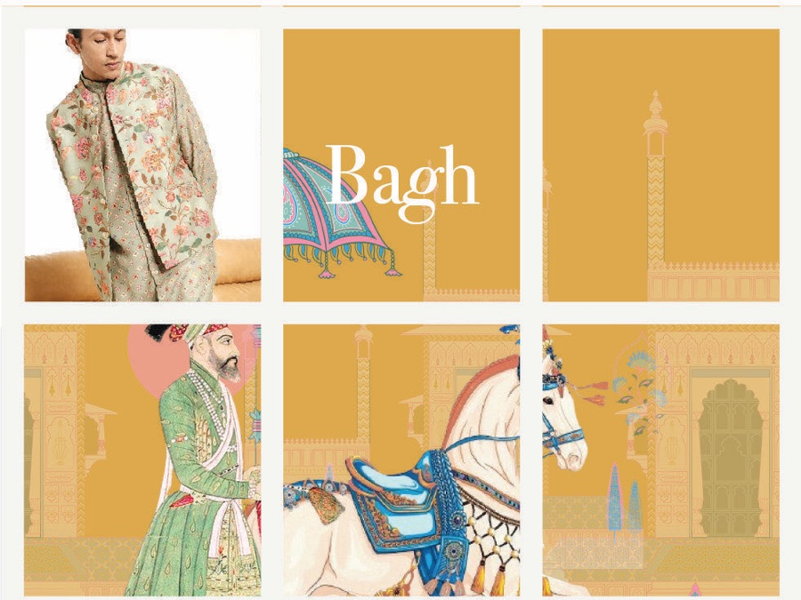

A men's edit pairing colour-washed looks with illustrated "Shop the Look" accessory spreads.

[View editorial](assets/projects/img/rangrez.jpg) · [Watch walkthrough](assets/projects/video/rangrez.mp4)

### Festive Blooms
*Editorial · ICH Creative Consulting*

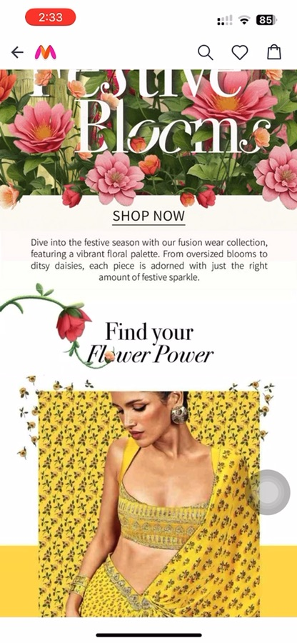

A women's ethnic festive edit on Myntra built around a "Find your Flower Power" theme.

[Watch walkthrough](assets/projects/video/festive-blooms.mp4)

### Slaylist — Work Edition
*Editorial · ICH Creative Consulting*

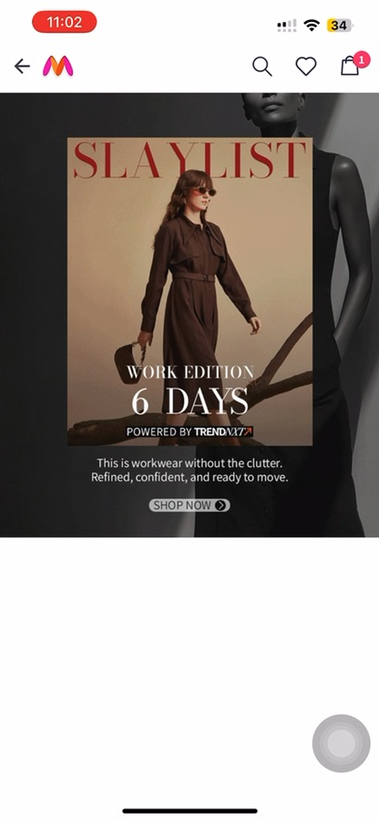

A six-day workwear edit on Myntra, styled as a magazine cover series.

[Watch walkthrough](assets/projects/video/slaylist.mp4)

### Riwaaz
*Editorial · ICH Creative Consulting*

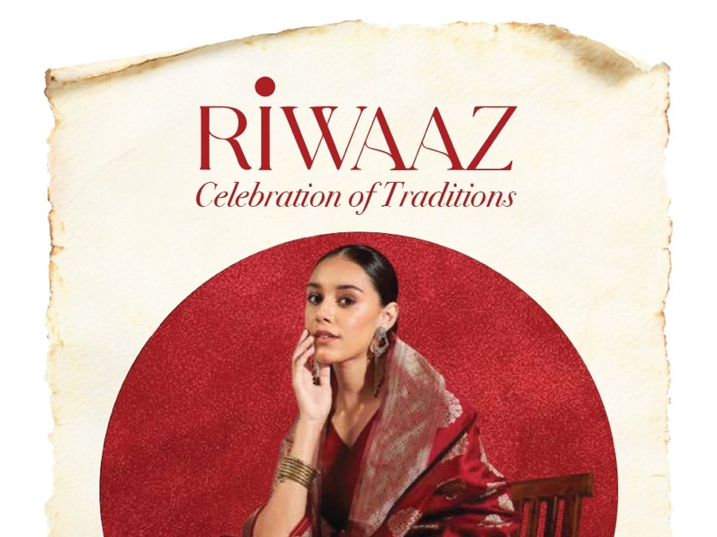

A regional festive-looks editorial, opening with "The Calcutta Bae", a classic Bengali puja look styled with matching beauty picks.

[View editorial](assets/projects/img/riwaaz.jpg)

### The Scent Story
*Editorial · ICH Creative Consulting*

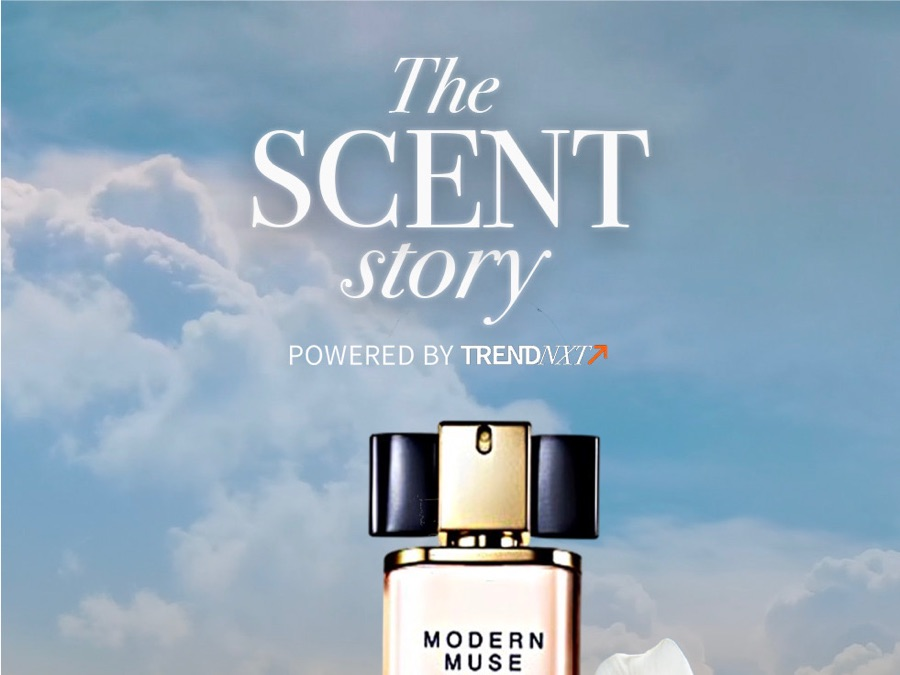

A fragrance editorial presenting each scent through collaged notes and botanicals.

[View editorial](assets/projects/img/the-scent-story.jpg)

### The Shoe Edit
*Editorial · ICH Creative Consulting*

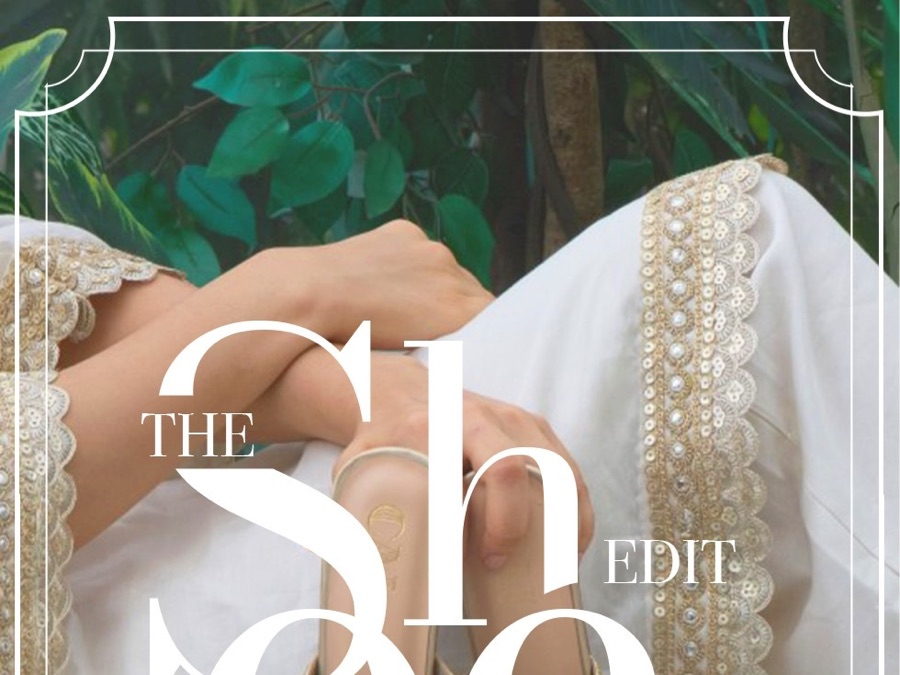

A festive footwear edit — bling slippers, embroidered styles and more — framed with fine gold line illustration.

[View editorial](assets/projects/img/the-shoe-edit.jpg)

### Festive Mixtape
*Editorial · ICH Creative Consulting*

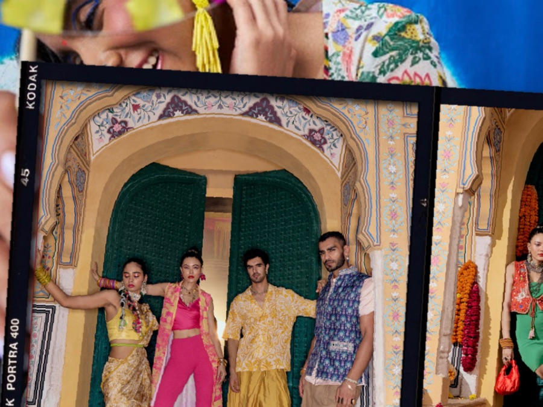

A festive editorial remixing traditional wear with street style, from "Singles That Mingle" to "The Art of Fusion Dressing".

[View editorial](assets/projects/pdf/festive-mixtape.pdf)

### Loom to Boardroom
*Editorial · ICH Creative Consulting*

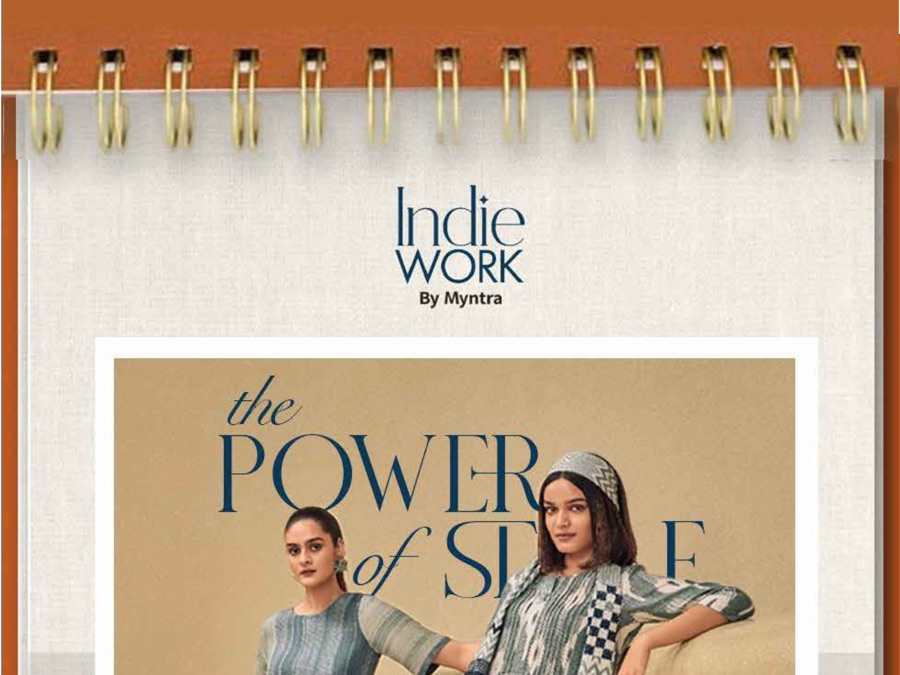

An Indie Work editorial for Myntra mapping women's ethnic workwear to moments like presentation day, interviews and networking.

[View editorial](assets/projects/pdf/indie-work-editorial.pdf)

### The Bra Code
*Editorial · ICH Creative Consulting*

A lingerie edit for Myntra's TrendNXT with an envelope-style hero, a style-by-style guide and a "Self Care Sunday" mood.

[View editorial](assets/projects/pdf/lingerie-edit.pdf)

### ICH Next
*Campaign video · ICH Creative Consulting*

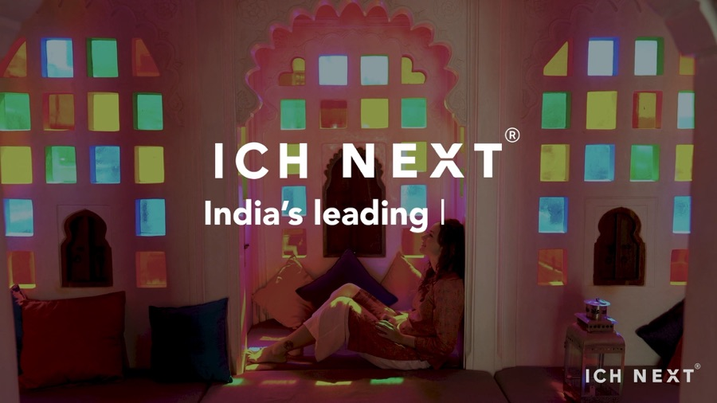

A brand film introducing ICH Next.

[Watch video](assets/projects/video/ich-next.mp4)

### ICH Creative Website Film
*Campaign video · ICH Creative Consulting*

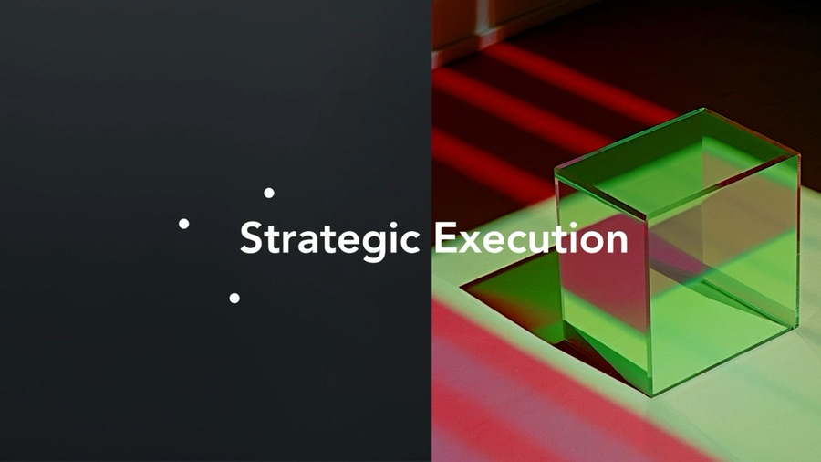

A short film made for the ICH Creative website.

[Watch video](assets/projects/video/ich-creative-website.mp4)

### Lal & Co Reel
*Campaign video · ICH Creative Consulting*

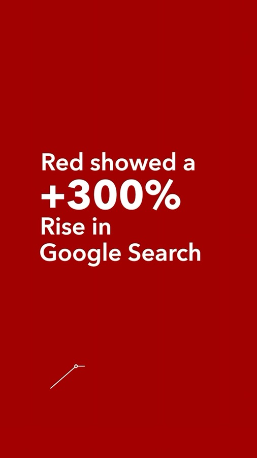

A short social reel on the rise of red, opening with a +300% jump in Google searches.

[Watch video](assets/projects/video/lal-and-co-reel.mp4)

### Fabindia Logo Redesign
*Branding & UX · Concept*

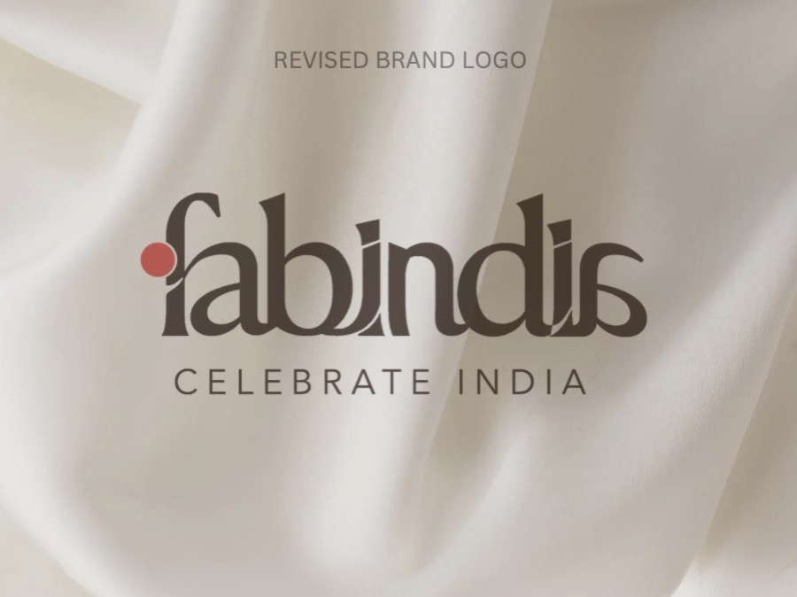

A concept redesign of the Fabindia logo: a red dot that reads as a bindi, a clean modern sans-serif, the "Celebrate India" tagline, an earthy six-colour palette and business-card mockups.

[View project](assets/projects/pdf/fabindia-logo.pdf) · [View moodboard](assets/projects/img/workflow-sheet.jpg)

### Tactile Together
*Branding & UX · Brand identity*

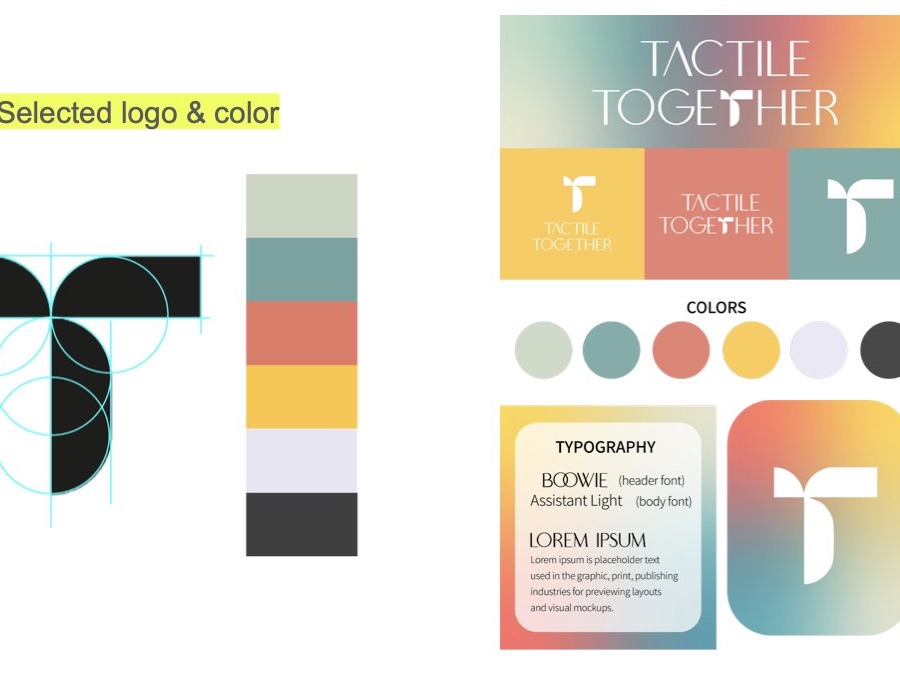

A brand identity for an inclusive, human-centred design studio — positioning, moodboard, three palettes and three logo concepts, ending in a T monogram on a construction grid.

[View project](assets/projects/pdf/tactile-together.pdf)

### Birla Opus — Screen to Space
*Branding & UX · UX pitch*

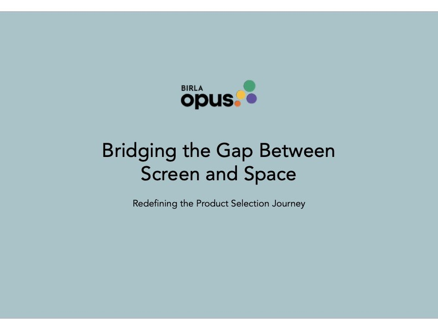

A UX pitch for Birla Opus's online wallpaper journey: an "Inspire › Clarify › Imaginate" flow with shop-by-room, a lighting toggle, a roll calculator and an in-page visualiser.

[View deck](assets/projects/pdf/birla-opus-pitch-deck.pdf)

### Metaverse Fashion Marketing
*MA research · University of Southampton*

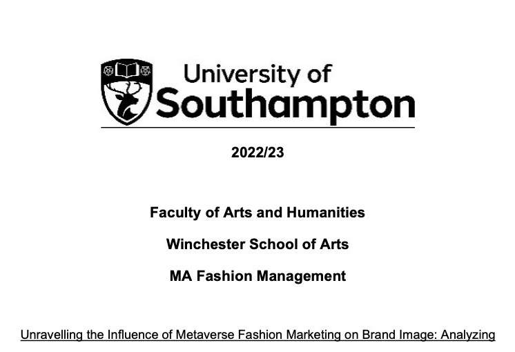

My MA dissertation on how metaverse marketing — digital storefronts, virtual events — shapes fashion brand image, based on interviews with industry experts.

[Read dissertation](assets/projects/pdf/metaverse-fashion-marketing.pdf)

### Vave
*MA research · University of Southampton*

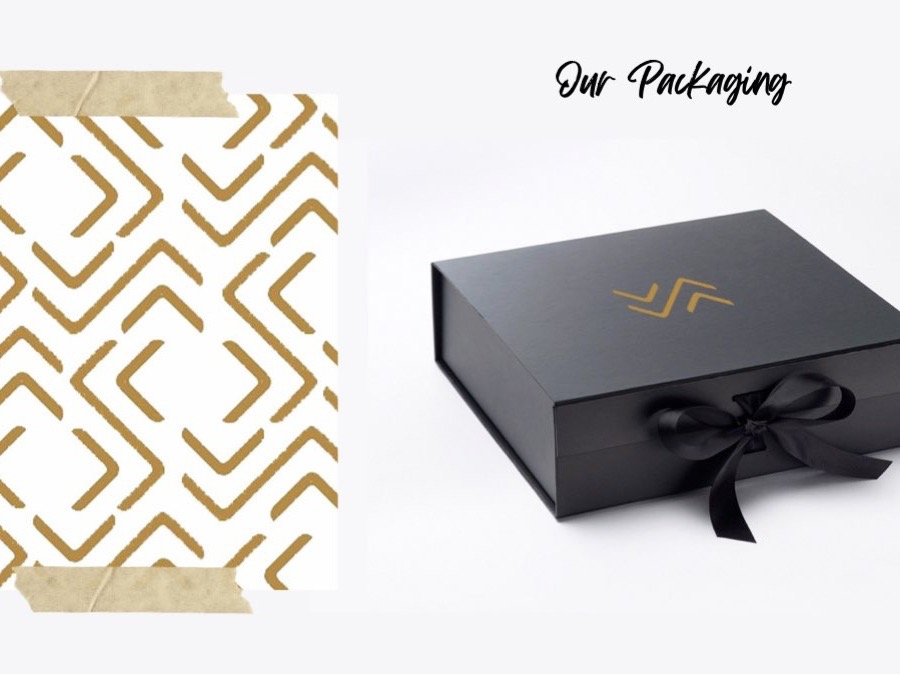

A sustainable, gender-fluid fashion brand built from scratch: consumer persona, wave logo, a kintsugi "Broken is Beautiful" AW24 concept, TENCEL sourcing and packaging.

[View presentation](assets/projects/pdf/vave-presentation.pdf) · [Read report](assets/projects/pdf/vave-illustrated-report.pdf)

### Kilt Me, Baby.
*MA research · University of Southampton*

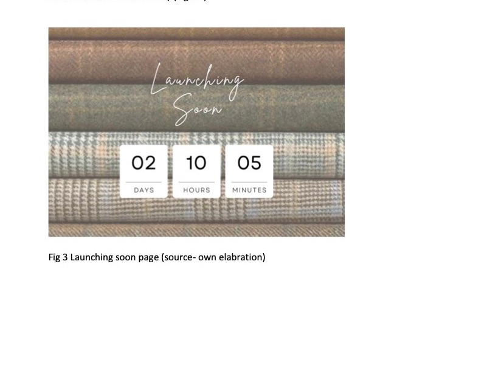

A concept digital display and 2025 website launch for a sustainable Scottish kilt brand — interactive features, an inclusive campaign script and launch KPIs.

[View project](assets/projects/pdf/kilt-me-baby.pdf)

## Instagram

I manage Instagram for ICH NEXT®, India's first indigenous trend forecast for fashion retail.

*@ichnext.official · public profile stats, last updated 8 November 2026*

- **13.1k** followers
- **6,992** views on the top reel
- **1,880** average views per reel
- **22.6k** views across the last 12 reels
- **3** reels passed 4,000 views

**Views on the last 12 reels, oldest to newest**

- [4,135](https://www.instagram.com/ichnext.official/reel/Delij4qq2vO/)
- [590](https://www.instagram.com/ichnext.official/reel/DeoMWftKNlS/)
- [489](https://www.instagram.com/ichnext.official/reel/DeqpakkquzN/)
- [830](https://www.instagram.com/ichnext.official/reel/DetHdUiqGf9/)
- [905](https://www.instagram.com/ichnext.official/reel/DeyRZQaqPYB/)
- [769](https://www.instagram.com/ichnext.official/reel/De09Y9fqaJJ/)
- [1,084](https://www.instagram.com/ichnext.official/reel/De3XAODq2fu/)
- [1,305](https://www.instagram.com/ichnext.official/reel/De_UGhqqvms/)
- [4,520](https://www.instagram.com/ichnext.official/reel/DfMTCFKqAL9/)
- [6,992](https://www.instagram.com/ichnext.official/reel/DfPW7UfTCqV/)
- [523](https://www.instagram.com/ichnext.official/reel/DfRQ7yuK1wv/)
- [413](https://www.instagram.com/ichnext.official/reel/DfV3oAkqDpX/)

[Watch the top reel](https://www.instagram.com/ichnext.official/reel/DfPW7UfTCqV/) · [Visit @ichnext.official](https://www.instagram.com/ichnext.official/)

## Experience

### Editorial & Content Lead — ICH Creative Consulting LLP
*June 2024 – Present*

Editorial & Content Lead since June 2025; Editorial Designer, June 2024 – May 2025.

- **Secured business expansion:** Contributed to Myntra extending and expanding its contract, resulting in ~38% business growth.
- **Editorial strategy:** Planned and structured the editorial calendar, aligning content strategies and curation with consumer sentiment and upcoming fashion trends.
- **Creative direction:** Oversaw end-to-end execution of digital editorials, from visual storytelling to narrative building.
- **Campaign & marketing content:** Designed in-house marketing content and campaigns to strengthen brand engagement.

### Assistant Event Coordinator — The Twenty Two
*September 2023 – December 2023*

- Part of the event management team organizing high-profile events, including the Jimmy Choo new launch after-party, the Barbie cast celebratory dinner, and the Jimmy Choo Christmas party.

### Digital Marketing Executive — Dekoded
*March 2022 – September 2022*

- Drove online engagement and strengthened brand presence through targeted campaigns.
- Developed innovative product and packaging design solutions aligned with brand identity.

### Project Intern — Aditya Birla Fashion and Retail (ABFRL)
*June 2021 – November 2021*

- Contributed to a pilot project for a Dubai-based brand, focusing on competitive brand analysis, merchandising strategy, and market research.

### Accessories Designer — Aditya Birla Fashion and Retail (ABFRL)
*January 2021 – March 2021*

- Designed 3D accessories for men's ethnic wear as part of a pilot project for Tasva.
- Developed a men's gifting accessory concept for ABFRL employees.

## Education

### MA, Fashion Management — University of Southampton
*September 2022 – September 2023*

Major: Brand Development · Minor: Visual Language of Design

### B.Des, Accessory Design — NIFT Mumbai
*July 2017 – May 2021*

Major: Accessory Design · Minor: Fashion Communication

## Skills

### Strengths

- Creative storytelling & visual communication
- Collaboration & stakeholder management
- Attention to detail
- Time & pressure management
- Problem-solving & quick learning

### Software

- Figma
- Adobe Photoshop
- Adobe Illustrator
- Adobe InDesign
- Adobe After Effects
- Adobe Premiere Pro
- Adobe XD
- Adobe Dimension
- Fusion 360

### AI Tools

- Midjourney
- Gemini
- ChatGPT

## Contact

I'd love to hear about editorial, content, and brand projects.

[Saakshikhadgi912@gmail.com](mailto:Saakshikhadgi912@gmail.com) · [LinkedIn](https://www.linkedin.com/in/sakshi-khadgi-005890156/)
